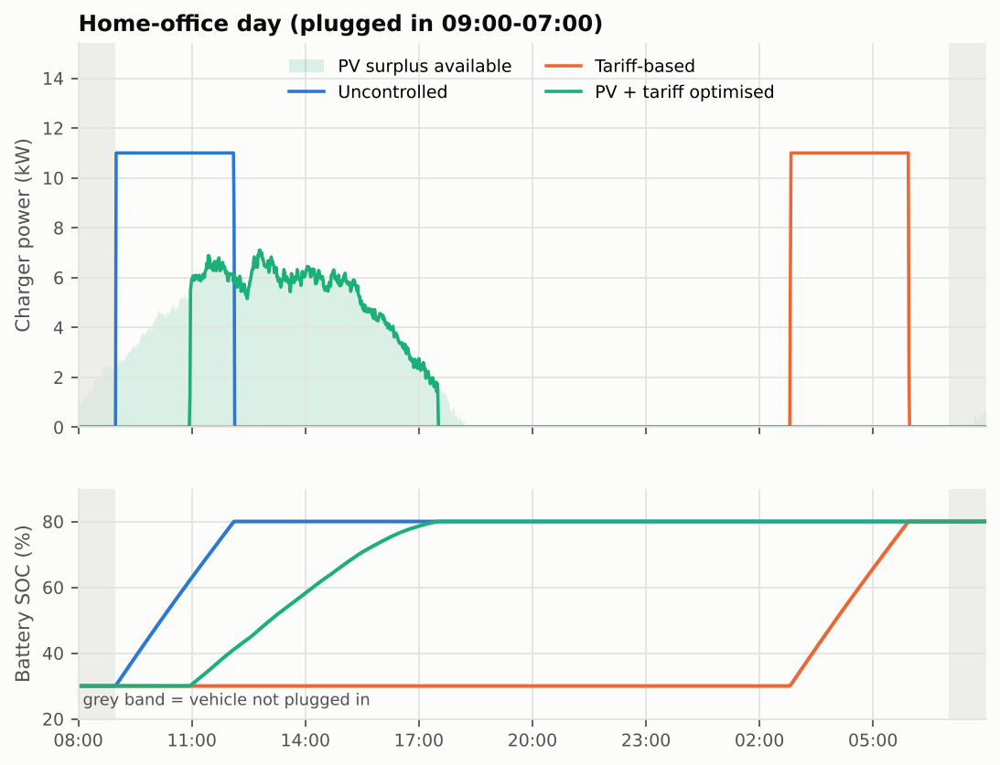
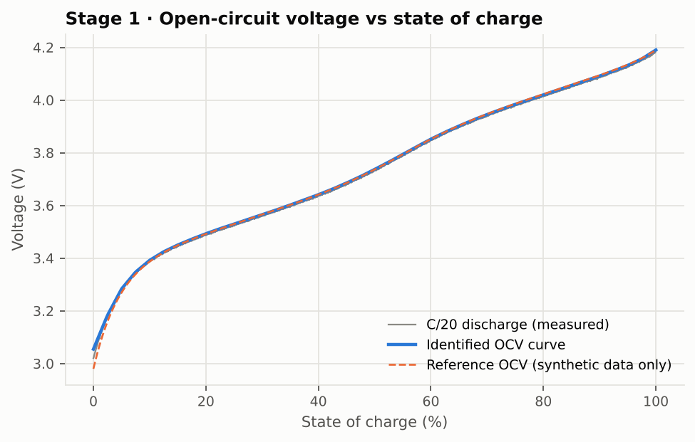
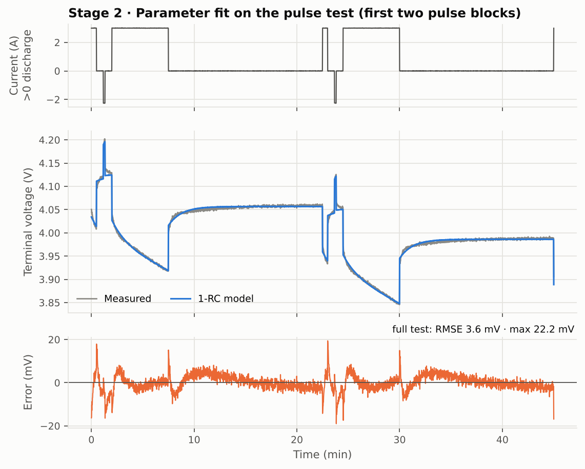
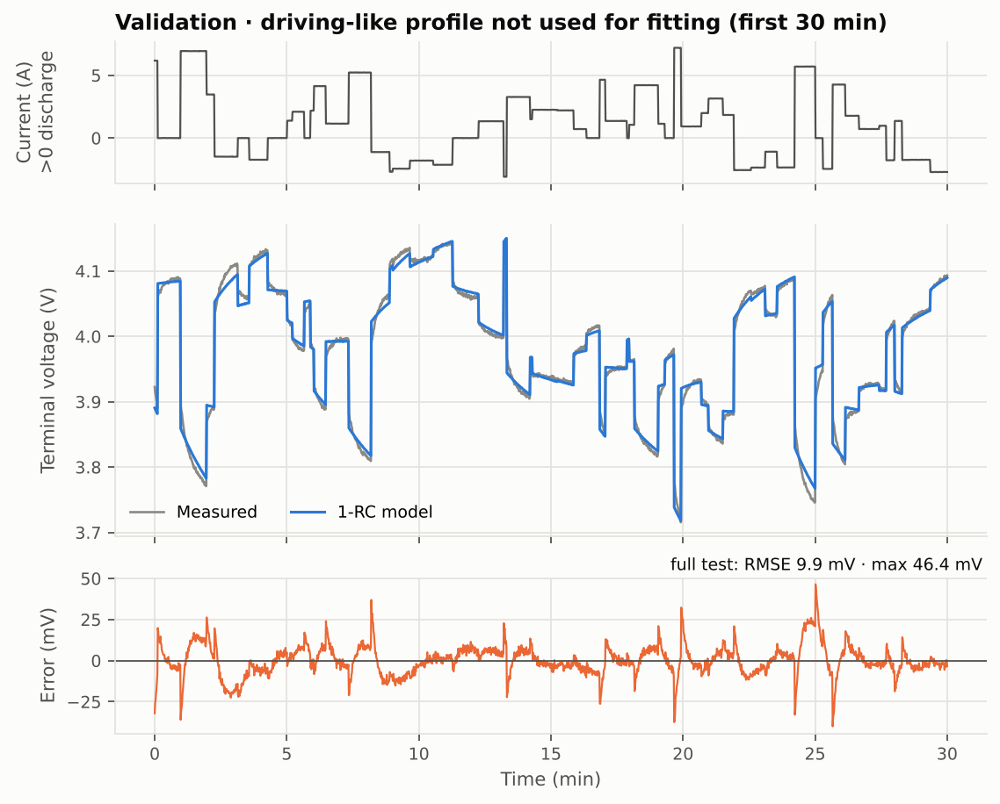
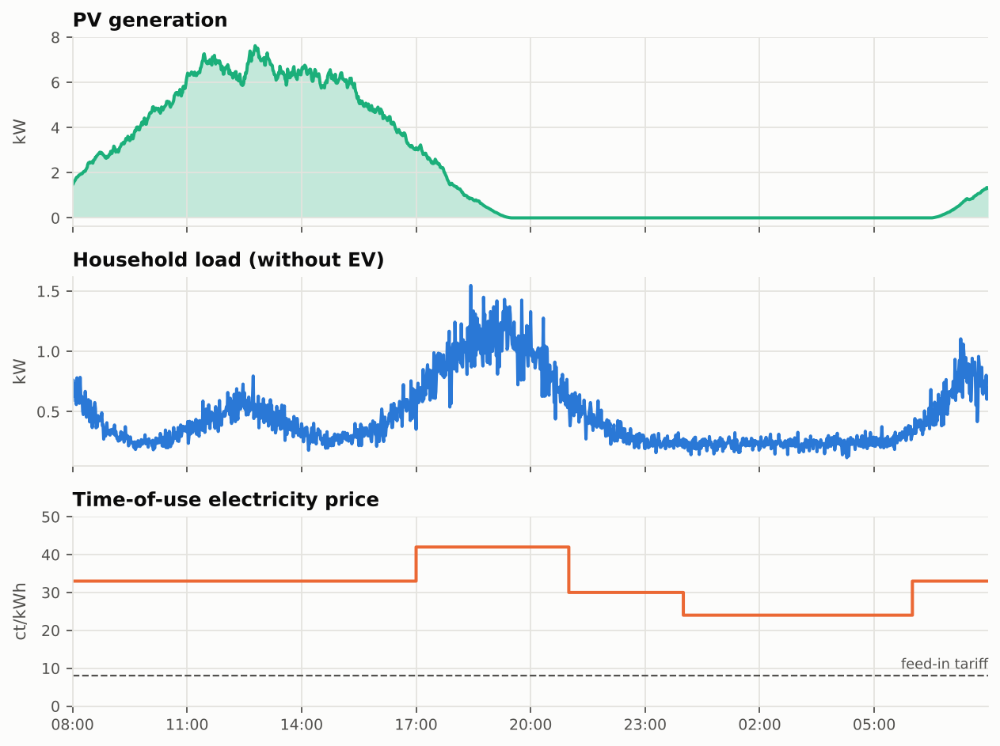
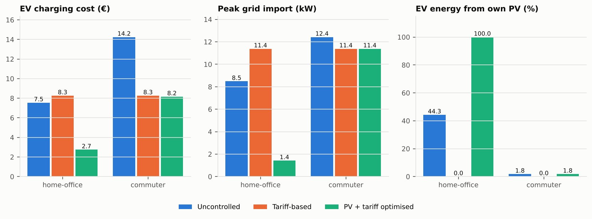
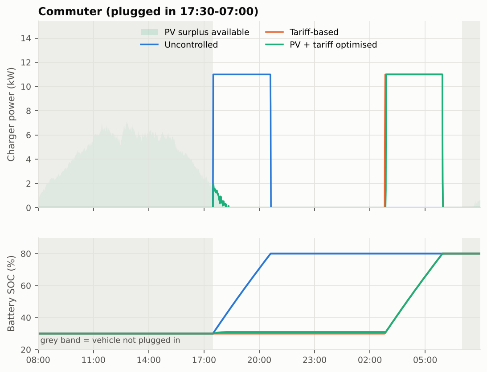
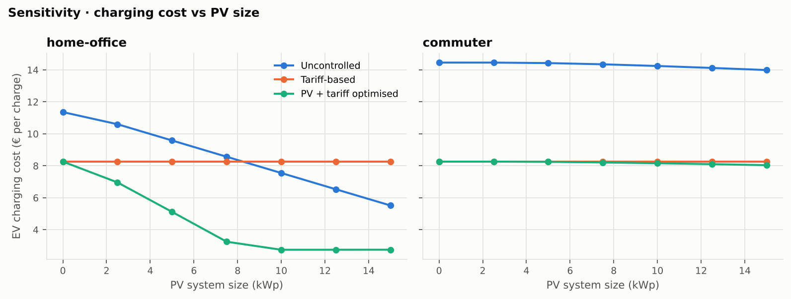

# EV Battery Modelling & Smart Charging Simulation

Python study that links **battery cell modelling** with the **home energy system** an electric vehicle is charged in. A first-order equivalent circuit model (ECM) is identified from cell test data, scaled to a 62 kWh EV pack, and used to evaluate three charging strategies under rooftop PV generation and a time-of-use electricity tariff.

**Question:** *How much can smart charging with PV and variable prices reduce charging cost and grid load, and how does the battery behave while doing it?*



---

## Key results (default configuration)

| Scenario | Strategy | EV charging cost | Cost per kWh | Peak grid import | EV energy from own PV |
|---|---|---:|---:|---:|---:|
| Home-office day | Uncontrolled | 7.55 € | 21.9 ct | 8.5 kW | 44 % |
| Home-office day | Tariff-based | 8.26 € | 24.0 ct | 11.4 kW | 0 % |
| Home-office day | **PV + tariff optimised** | **2.75 €** | **8.0 ct** | **1.4 kW** | **100 %** |
| Commuter | Uncontrolled | 14.24 € | 41.4 ct | 12.4 kW | 2 % |
| Commuter | **Tariff-based** | **8.26 €** | **24.0 ct** | 11.4 kW | 0 % |
| Commuter | PV + tariff optimised | 8.16 € | 23.7 ct | 11.4 kW | 2 % |

*One charge from 30 % to 80 % SOC (≈ 34 kWh from the grid connection), 10 kWp PV, 11 kW wallbox. "EV charging cost" is the increase in the household electricity bill caused by charging, including lost feed-in revenue for PV energy used in the car.*

**Findings**

1. **When the car is at home during the day, PV-aware charging cuts the charging cost by ~64 %** compared with uncontrolled charging (2.75 € vs 7.55 €), and the peak grid import falls from 8.5 kW to 1.4 kW. The remaining cost is the feed-in revenue given up by using the PV energy in the car.
2. **A tariff-only strategy can be worse than doing nothing.** On the home-office day it shifts charging to the cheap night band and ignores free PV energy, so it ends up 9 % more expensive than uncontrolled charging.
3. **For a commuter, PV hardly matters; the tariff does.** Shifting charging to the night band saves ~42 % (8.26 € vs 14.24 €). Larger PV systems bring almost no further saving (see sensitivity study).
4. **Smart charging is also gentler on the battery here:** following the PV surplus charges at lower average power, which halves the simulated battery losses (0.09 vs 0.18 kWh). Charger losses (8 %) are far larger than battery losses (~0.5 %).

---

## Method

```
 cell test data ──► Stage 1: OCV-SOC ──► Stage 2: R0, R1, C1 ──► validation
                                                     │
                                                     ▼
 PV / load / tariff ──► charging strategy ──► pack simulation (ECM) ──► KPIs
                              ▲                      │
                              └── re-plan if target SOC is missed
```

### 1 · Battery model identification

The cell is described by a Thevenin model with one RC element:

$$
v = \mathrm{OCV}(\mathrm{SOC}) - R_0\, i - v_1,\qquad
\frac{dv_1}{dt} = -\frac{v_1}{R_1 C_1} + \frac{i}{C_1},\qquad
\frac{d\,\mathrm{SOC}}{dt} = -\frac{i}{3600\,Q}
$$

(current *i* > 0 = discharge). Parameters are identified in two stages, a common approach for ECMs ([NASA TM-20205008059](https://ntrs.nasa.gov/api/citations/20205008059/downloads/NASA-TM-20205008059.pdf)):

| Stage | Test | What is estimated | How |
|---|---|---|---|
| 1 | C/20 full discharge | Capacity *Q*, OCV(SOC) table | Coulomb counting, ohmic-drop correction, binned averaging |
| 2 | HPPC-like pulse test | R0, R1, τ1 = R1·C1 | Nonlinear least squares (`scipy.optimize.least_squares`) on the simulated terminal voltage |
| Validation | Driving-like dynamic profile | — | Profile **not used for fitting**; RMSE and max. error |

<p float="left">
  
  
</p>



**Identified parameters:** Q = 2.98 Ah, R0 = 32.5 mΩ, R1 = 13.7 mΩ, τ1 = 75 s.
**Accuracy:** 3.6 mV RMSE on the fitting data, **9.9 mV RMSE (46 mV max.) on the validation profile.**

The validation error is larger than the fitting error because the data come from a cell with *two* relaxation time constants (14 s and 250 s), while the model has only one. The error peaks visible after every current step are exactly this model-structure limitation, which is the main trade-off of 1-RC models.

### 2 · Pack and charging simulation

The identified cell is scaled to a **96s58p pack (≈ 350 V, 62 kWh)**. For every 1-minute step the cell current is solved from the requested DC power, `P = V(i) · i`, so voltage rise, polarisation and losses during charging come from the identified model.

**Home energy balance (AC side):** `grid import − grid export = household load + charger power − PV`

| Strategy | Logic | Information used |
|---|---|---|
| Uncontrolled | Full power (11 kW) from plug-in until 80 % SOC | none |
| Tariff-based | Linear program: minimise Σ price · P_charger · Δt | price only |
| PV + tariff optimised | Linear program: minimise the household bill (import cost − feed-in revenue) | PV, load and price forecasts |

Both optimisations are solved with the HiGHS solver through `scipy.optimize.linprog`. After planning, the schedule is simulated with the battery model; if battery losses leave the SOC below target, the energy requirement is increased and the schedule is re-planned (closed loop).



### 3 · Results





### 4 · Sensitivity study: PV system size



For the home-office case the optimised strategy saturates at about **10 kWp**: beyond that, the PV surplus already covers the whole charge and extra PV only increases export. For the commuter case, PV size has almost no influence because the car is rarely at home when the sun shines. This shows that **the value of smart charging depends more on when the car is plugged in than on the size of the PV system.**

---

## Limitations

These results come from a simplified simulation and should be read as trends, not exact values.

- **Synthetic cell data.** The repository ships with data generated by a 2-RC reference cell plus measurement noise, so it runs without downloads. The identification code works on real data unchanged (see *Using real data*).
- **No thermal or ageing model.** Resistance and capacity are constant; temperature and degradation effects on losses are not included.
- **Ideal forecasts.** The optimised strategy knows PV and load exactly. Real systems use forecasts with errors, which reduces the saving.
- **Continuous charger power.** Real wallboxes have a minimum current (typically 6 A, about 1.4 kW single-phase or 4.1 kW three-phase), so very low PV surplus cannot always be used.
- **One representative day** with a synthetic PV and load profile and a three-level tariff. Seasonal variation and dynamic (hourly spot) tariffs are not covered.
- **Constant charger efficiency** of 92 %; in reality it drops at low power.

---

## Repository structure

```
├── run.py                     # runs the full study
├── config/default.yaml        # all parameters of a case (pack, charger, PV, tariff, ...)
├── src/evcharge/
│   ├── ecm.py                 # Thevenin cell model and battery pack
│   ├── data.py                # synthetic test data and CSV loader
│   ├── identification.py      # two-stage parameter identification
│   ├── profiles.py            # PV, household load, time-of-use tariff
│   ├── charging.py            # charging strategies (LP), pack simulation, KPIs
│   └── plotting.py            # figures
├── tests/                     # pytest unit and integration tests
├── docs/literature.md         # short literature review on smart charging
├── data/README.md             # how to use real laboratory data
└── results/                   # generated: figures, KPI tables, time series
```

## Getting started

```bash
git clone https://github.com/pushkarb001/ev-battery-smart-charging.git
cd ev-battery-smart-charging
python -m venv .venv && source .venv/bin/activate   # Windows: .venv\Scripts\activate
pip install -r requirements.txt

python run.py                 # full study, ~10 s
python run.py --skip-sweep    # without the sensitivity study
python -m pytest              # run the tests
```

**New case:** copy `config/default.yaml`, change values (e.g. `pv.peak_kwp`, `charger.max_power_kw`, tariff bands, plug-in times) and run `python run.py --config config/my_case.yaml`. All figures and tables are regenerated in the configured `output_dir`.

### Outputs

| File | Content |
|---|---|
| `results/battery_parameters.json` | identified cell parameters and model errors |
| `results/ocv_table.csv` | identified OCV-SOC lookup table |
| `results/kpi_summary.csv` | KPIs for every scenario and strategy |
| `results/timeseries_*.csv` | 1-minute time series: PV, load, price, charger power, SOC |
| `results/sweep_pv_size.csv` | sensitivity study results |
| `results/figures/*.png` | all figures in this README |

## Using real data

Set `battery_identification.data_source: csv` in the config and provide three CSV files with the columns `time_s, current_a, voltage_v` (current > 0 = discharge): a low-rate discharge, a pulse test and a dynamic validation profile. Public cell datasets from NASA, CALCE, Oxford and HNEI are commonly used for this purpose and are collected in harmonised form in the [Battery Archive](https://www.batteryarchive.org/). See [`data/README.md`](data/README.md).

## Literature

A short review of smart charging approaches and the sources used in this project is in [`docs/literature.md`](docs/literature.md).

## Author

**Pushkar Vivek Bidnur** — M.Sc. Electromobility-ACES, FAU Erlangen-Nürnberg
GitHub: [pushkarb001](https://github.com/pushkarb001)

## License

MIT, see [LICENSE](LICENSE).
